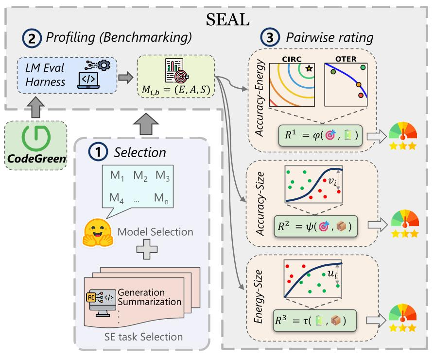
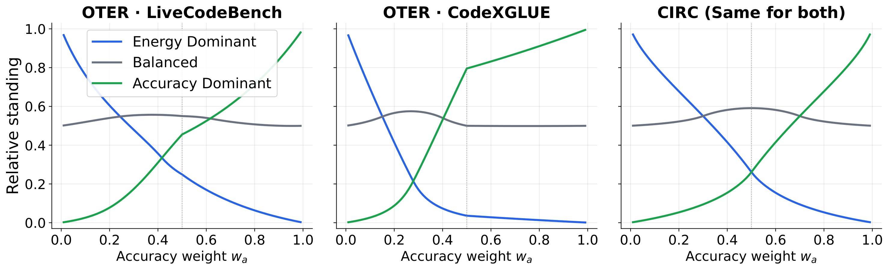

# SEAL: Benchmarking the Size, Energy, and Accuracy Trade-offs of Code Language Models 

## Overview

This repository is the replication package for **SEAL**, a framework that benchmarks Code Language Models (*CLMs*) jointly on **energy efficiency**, **functional correctness (accuracy)**, and **model size**, and reports each on a unified **1–5** scale. Instead of collapsing these competing dimensions into a single opaque score, SEAL decouples the evaluation into three interpretable **pairwise profiles** — energy–accuracy, size–accuracy, and size–energy.

We benchmark **33** state-of-the-art open-source *CLMs* on two software-engineering tasks — code generation ([LiveCodeBench](https://livecodebench.github.io/)) and code summarization ([CodeXGLUE](https://github.com/microsoft/CodeXGLUE)). Energy is measured locally with [CodeGreen](https://github.com/SMART-Dal/CodeGreen); accuracy and generation run on top of the [LM-Evaluation-Harness](https://github.com/EleutherAI/lm-evaluation-harness).



<br></br>


> Rapid AI adoption in software development demands evaluating code models' environmental costs alongside functional correctness. While prior studies examine large language models' sustainability, they lack a systematic, interpretable framework for jointly evaluating accuracy, energy, and size trade-offs in Code Language Models (*CLMs*). We present *SEAL*, an evaluation framework that benchmarks *CLMs* across energy efficiency, functional correctness, and size on a unified $1$--$5$ scale. Rather than one opaque score, *SEAL* decouples evaluation into three interpretable pairwise profiles. For energy-accuracy trade-off, we propose two priority-tunable rating methods. *Concentric Incremental Rating Circles* (*CIRC*) provides deterministic, distance-based rankings with static trade-offs, and *Observation to Expectation Rating* (*OTER*) provides trend-aware evaluations capturing dynamic trade-offs between objectives. Since model size dictates deployment feasibility on real hardware, we introduce scaling-law-based *Performance* and *Structural Efficiency* metrics, assessing how effectively a model converts its size into accuracy and energy savings. Benchmarking $33$ state-of-the-art *CLMs* on code generation and summarization, we find that achieving high accuracy is more challenging than attaining energy efficiency, and that small models are not inherently efficient. What distinguishes models is how effectively they translate parameters into capability. Together, the three profiles guide practitioners toward models that are accurate, sustainable, and deployable within their hardware limits.

### Research Questions

- **RQ1 — Energy–Accuracy rating.** Rate CLMs on their energy–accuracy trade-off with a unified method (CIRC, OTER). *(22-model base cohort.)*
- **RQ2 — Rating distribution shift.** Grow the cohort from 22 → 33 models and verify that ratings/ordering stay stable and justified.
- **RQ3 — Priority elasticity.** Sweep accuracy/energy weights (`w_a`, `w_e`) and verify the weighted CIRC/OTER stay monotonic, continuous, and interpretable.
- **RQ4 — Scaling-law efficiencies.** Rate how efficiently each model turns its size into accuracy (Performance Efficiency, ψ) and energy savings (Structural Efficiency, τ).

---

## Repository Map

High-level map of the most relevant parts of the repo.

```
├── lm_eval
│   ├── main_run.py              # entry point: run models on benchmarks + energy profiling
│   ├── run_config.yaml          # models/tasks/quantization to run
│   ├── configs.py               # paths & defaults (default output: results/results.jsonl)
│   ├── models/huggingface.py    # HF model backend
│   ├── tasks/
│   │   ├── LiveCodeBench/        # code generation (pass@1)
│   │   └── code_x_glue/          # code summarization (smoothed BLEU)
│   ├── results/                 # result files (see "Result files" below)
│   └── rating_llms/             # the SEAL rating methods
│       ├── methods/             # circ, oter, size_acc, size_ene
│       ├── validation/          # statistical validation suites (RQ1–RQ4)
│       ├── model_sizes.json     # frozen, versioned model sizes used by RQ4
│       └── utils/
├── RQ_experiments               # scripts that reproduce the paper's tables/figures
│   ├── RQ1/  RQ2/  RQ3/  RQ4/    # generate_*.py / analyze_*.py -> report/
│   └── Motivation/
└── reproducibility              # manifest of exact model/dataset revisions + lockfile
```

### Result files (`lm_eval/results/`)

| File | Contents | Used for |
|------|----------|----------|
| `partial_results_codegreen_.jsonl` | 22 base models × 2 tasks | **RQ1** |
| `final_results_codegreen.jsonl`    | 33 models × 2 tasks       | **RQ2, RQ3, RQ4** |
| `results.jsonl`                    | raw run log (repeated runs, many models) | default `main_run.py` sink |

> **Note.** Each curated file holds **one aggregated row per model per task**. The raw `results.jsonl` contains **repeated runs** of each model; the rating scripts do **not** deduplicate or average, so point them at the curated `*_codegreen*.jsonl` files (or aggregate `results.jsonl` first) to reproduce the paper.

---

## Install
```bash
git clone git@github.com:SMART-Dal/LLM-Sustainability-Rater.git
cd LLM-Sustainability-Rater
python3 -m venv venv
source venv/bin/activate
pip install --no-cache-dir -e .
```

For the exact, fully pinned environment install from the lockfile instead:
```bash
pip install --require-hashes -r reproducibility/requirements.lock.txt
pip install --no-deps -e .
```

### Replication notes (pinning)

To reproduce the **accuracy** numbers in `lm_eval/results/`, pin the generation stack after the editable install:

1. **Two models need a one-line `tokenizer_config.json` patch under transformers 4.55.0.** They ship `"extra_special_tokens"` as a list, but 4.55.0 expects a dict (fixed in 5.x). Affected: `ryzdfm/qwen2.5-coder-3b-claude_opus_4.6-distilled`, `dcostenco/prism-coder-7b`. After the model downloads, edit `~/.cache/huggingface/hub/models--<owner>--<name>/snapshots/<rev>/tokenizer_config.json` and set `"extra_special_tokens"` to `{}`. This is functionally neutral for these benchmarks (the tokens remain in `tokenizer.json`/`special_tokens_map.json`; only the named-attribute accessors are dropped, which the pipeline does not use).

---

## Usage

### 0. Environment
Create a `.env` file with your HuggingFace token (used to download models; RQ4 reads the sizes of the paper's 33 models from `lm_eval/rating_llms/model_sizes.json` and only queries the Hub for models not listed there):
```
HF_TOKEN=YOUR_TOKEN
```

### 1. Run models & measure energy + accuracy (`main_run.py`)
```bash
cd lm_eval
# edit run_config.yaml first (see below), then:
python main_run.py
```
Configure `run_config.yaml`:
- `model`: `hf` (run base HF models without optimizations).
- `tasks`: benchmark task names (`lm-eval --tasks list`); this study uses `livecodebench` and `code2text_python`.
- `model_args`: any argument `AutoModel.from_pretrained` accepts.
- `bnb_config`: per-model bitsandbytes quantization (index-aligned with `model_args`); e.g. `load_in_4bit=True`.
- `experiments_run`: a tag stored in the results for later filtering.

Each model runs **sequentially**, one task at a time. Results append to `results/results.jsonl`; per-model energy logs land in `codegreen_log/{task_name}/{model_name}/{stage}.log`.

### 2. Energy–Accuracy rating — CIRC & OTER (RQ1–RQ3)
Run from the **repo root**:
```bash
# CIRC (deterministic, distance-based)
python -m lm_eval.rating_llms.methods.circ \
    --task_name livecodebench \
    --file_name lm_eval/results/partial_results_codegreen_.jsonl

# OTER (trend-aware)
python -m lm_eval.rating_llms.methods.oter \
    --task_name code2text_python \
    --file_name lm_eval/results/partial_results_codegreen_.jsonl
```
Flags:
- `--task_name` (required): `livecodebench` or `code2text_python`.
- `--file_name` (default `lm_eval/results/results.jsonl`): the `.jsonl` result file.
- `--w_a` / `--w_e` (optional): accuracy / energy priority weights, must sum to 1 (default `0.5`/`0.5`). Passing one infers the other. `w_e=1` → pure energy, `w_e=0` → pure accuracy.

**Output** → `lm_eval/rating_llms/data/acc_ene/{METHOD}_{file}_{task}_wa_{wa}_we_{we}/` containing `rating.xlsx` and the rating-region plot (`distance.pdf` for CIRC, `regression.pdf` for OTER).

### 3. Size-efficiency rating — Performance (ψ) & Structural (τ) Efficiency (RQ4)
```bash
# size vs accuracy  (Performance Efficiency, ψ)
python -m lm_eval.rating_llms.methods.size_acc \
    --task_name livecodebench \
    --file_name lm_eval/results/final_results_codegreen.jsonl

# size vs energy    (Structural Efficiency, τ)
python -m lm_eval.rating_llms.methods.size_ene \
    --task_name livecodebench \
    --file_name lm_eval/results/final_results_codegreen.jsonl
```
Model sizes are fetched from HuggingFace (memory footprint in GB) and cached in `lm_eval/rating_llms/data/acc_size/model_sizes_cache.json`.
**Output** → `data/acc_size/{file}_{task}/` and `data/size_ene/{file}_{task}/` (`rating.xlsx` + rating plot).

### 4. Reproduce the paper's tables, figures, and statistics

**Per-RQ tables & figures** (written to each `RQ_experiments/RQ*/report/`):
```bash
python RQ_experiments/RQ1/generate_rq1.py   # Table 1 + rq1_plot_grid.pdf  (22 models)
python RQ_experiments/RQ2/generate_rq2.py   # Table 2 + rq2_plot_grid.pdf  (33 models)
python RQ_experiments/RQ2/generate_rq2_evolution.py   # rq2_evolution_panels_codexglue.pdf + rq2_evolution_panels_livecodebench.pdf
python RQ_experiments/RQ3/analyze_rq2.py    # rq2_analysis.txt (validation and statistical test)
python RQ_experiments/RQ3/generate_rq3.py   # weight-sweep grid, continuity & sensitivity figs
python RQ_experiments/RQ3/analyze_rq3.py    # rq3_analysis.txt (weighted-rating validation)
python RQ_experiments/RQ4/generate_rq4.py   # Table 3 + size-acc / size-ene plots
python RQ_experiments/RQ4/analyze_rq4.py    # rq4_analysis.txt (in-depth size analysis)
```

**Statistical validation suites** (from the repo root):
```bash
python -m lm_eval.rating_llms.validation.validation_base      # RQ1: Kruskal-Wallis size-bias, LOO, noise, OTER hyperparam & outlier sensitivity
python -m lm_eval.rating_llms.validation.rating_stability     # RQ2: ordering stability & rating shifts (needs RQ1+RQ2 tables generated first)
python -m lm_eval.rating_llms.validation.validation_scaling   # RQ4: orthogonality, LOO, noise, size-regime extrapolation
# RQ3 weighted-rating validation is invoked by RQ_experiments/RQ3/analyze_rq3.py
```

---

## Results

### RQ1 — Energy–Accuracy ratings (22 base models)
Normalized accuracy (`A`) and energy efficiency (`E`), with CIRC/OTER ratings per benchmark (LCB = LiveCodeBench, CXG = CodeXGLUE). These are regenerated by `RQ_experiments/RQ1/generate_rq1.py`.

| ID  | Model | LCB A | LCB E | CXG A | CXG E | LCB CIRC | LCB OTER | CXG CIRC | CXG OTER |
|-----|-------|:-----:|:-----:|:-----:|:-----:|:--------:|:--------:|:--------:|:--------:|
| M1  | deepseek-coder-6.7b-base        | 0.23 | 0.31 | 0.47 | 0.23 | 2 | 1 | 2 | 3 |
| M2  | starcoderbase-1b                | 0.00 | 0.93 | 0.00 | 0.88 | 2 | 1 | 2 | 1 |
| M3  | starcoder2-3b                   | 0.02 | 0.23 | 0.37 | 0.32 | 1 | 1 | 2 | 3 |
| M4  | CodeLlama-7b-Instruct-hf        | 0.21 | 0.82 | 0.76 | 0.23 | 3 | 1 | 3 | 4 |
| M5  | Qwen2.5-Coder-3B-Instruct       | 0.52 | 0.95 | 0.36 | 0.57 | 4 | 3 | 3 | 3 |
| M6  | Qwen2.5-Coder-7B-Instruct       | 0.38 | 0.78 | 0.36 | 0.76 | 3 | 2 | 3 | 3 |
| M7  | Qwen2.5-Coder-1.5B              | 0.48 | 0.99 | 0.31 | 0.88 | 4 | 3 | 3 | 3 |
| M8  | deepseek-coder-1.3b-base        | 0.10 | 0.76 | 0.70 | 0.79 | 2 | 1 | 4 | 5 |
| M9  | deepseek-coder-7b-instruct-v1.5 | 0.58 | 0.77 | 0.35 | 0.35 | 4 | 3 | 2 | 2 |
| M10 | starcoder2-7b                   | 0.04 | 0.15 | 0.56 | 0.21 | 1 | 1 | 2 | 3 |
| M11 | codegen-350M-mono               | 0.02 | 0.83 | 0.09 | 0.83 | 2 | 1 | 2 | 1 |
| M12 | Qwen2.5-Coder-0.5B              | 0.27 | 0.99 | 0.37 | 0.88 | 3 | 2 | 3 | 3 |
| M13 | Yi-Coder-9B                     | 0.33 | 0.00 | 0.16 | 0.00 | 1 | 1 | 1 | 1 |
| M14 | rombos_Replete-Coder-Llama3-8B  | 0.21 | 0.74 | 0.20 | 0.28 | 3 | 1 | 2 | 2 |
| M15 | speechless-code-mistral-7b-v1.0 | 0.31 | 0.85 | 0.37 | 0.60 | 3 | 2 | 3 | 3 |
| M16 | stable-code-3b                  | 0.06 | 0.68 | 0.53 | 0.67 | 2 | 1 | 3 | 4 |
| M17 | CodeLlama-7b-Python-hf          | 0.15 | 0.73 | 0.38 | 0.23 | 2 | 1 | 2 | 2 |
| M18 | Seed-Coder-8B-Instruct          | 1.00 | 0.88 | 0.31 | 0.59 | 5 | 5 | 3 | 2 |
| M19 | CodeQwen1.5-7B-Chat             | 0.06 | 0.99 | 0.03 | 1.00 | 2 | 1 | 2 | 1 |
| M20 | Magicoder-S-DS-6.7B             | 0.42 | 0.62 | 0.39 | 0.42 | 3 | 2 | 3 | 3 |
| M21 | granite-8b-code-base-4k         | 0.10 | 1.00 | 1.00 | 0.14 | 2 | 1 | 2 | 5 |
| M22 | codegen-2B-mono                 | 0.02 | 0.64 | 0.45 | 0.51 | 2 | 1 | 3 | 3 |

The full **33-model** ratings (RQ2), the **weighted** ratings (RQ3), and the **size-efficiency** ratings ψ/τ (RQ4) are regenerated into `RQ_experiments/RQ2/report/`, `RQ3/report/`, and `RQ4/report/` respectively (`*_table.xlsx`, `*_table.tex`, and `*.pdf` figures).

### RQ3 — Weight sensitivity



*Relative standing of dominant-objective archetypes (eff = 0.9, acc = 0.1 or vice versa) and a balanced one (0.5, 0.5) as the accuracy weight `w_a` increases, scored against a dense synthetic field. OTER depends on the per-task curve, while CIRC is geometric and task-independent.*

### Generated artifacts per RQ

| RQ | Command | Key outputs (`RQ_experiments/RQ*/report/`) |
|----|---------|--------------------------------------------|
| RQ1 | `generate_rq1.py` | `rq1_table.{xlsx,tex}`, `rq1_plot_grid.pdf` |
| RQ2 | `generate_rq2.py`, `generate_rq2_evolution.py`, `analyze_rq2.py` | `rq2_table.{xlsx,tex}`, `rq2_plot_grid.pdf`, `rq2_evolution_analysis.txt`, `rq2_evolution_panels_codexglue.pdf`, `rq2_evolution_panels_livecodebench.pdf`, `rq2_evolutuon_ratings.xlsx` |
| RQ3 | `generate_rq3.py`, `analyze_rq3.py` | `rq3_weight_grid.pdf`, `rq3_continuity.pdf`, `rq3_weight_sensitivity.pdf`, `rq3_weight_ratings.xlsx`, `rq3_analysis.txt` |
| RQ4 | `generate_rq4.py`, `analyze_rq4.py` | `rq4_table.{xlsx,tex}`, `rq4_size_acc_plot.pdf`, `rq4_size_ene_plot.pdf`, `rq4_analysis.txt` |

---

## Reproducibility Manifest

| File | What it pins |
|------|--------------|
| `reproducibility/manifest.json` | Exact Hugging Face revision (commit hash + date), license, and parameter count of all 33 models and both datasets, plus the run labels and run period of `final_results_codegreen.jsonl`. |
| `lm_eval/rating_llms/model_sizes.json` | Versioned model sizes (GiB of weight files) used by the RQ4 size-efficiency ratings; read by `get_model_size_gb`, so RQ4 needs no Hub lookup. |
| `reproducibility/requirements.lock.txt` | Full dependency closure of `pyproject.toml` (150 packages) with exact versions and sha256 hashes (Python 3.10, Linux x86_64). |
| `reproducibility/build_manifest.py` | Regenerates the two JSON files: for each model/dataset it takes the last commit on `main` at or before the run (`main_run.py` downloads `main` right before running). |
| `reproducibility/build_lock.py` | Regenerates the lockfile by resolving the `pyproject.toml` pins with pip (dry run, nothing installed). |

---

## Data License and Provenance

**Datasets.** Both benchmarks are loaded from the Hugging Face Hub at the revisions below (see `reproducibility/manifest.json`).

| Task | Dataset | Revision | What we use | Source and license |
|------|---------|----------|-------------|--------------------|
| Code generation | [`livecodebench/code_generation_lite`](https://huggingface.co/datasets/livecodebench/code_generation_lite) (`release_v6`) | `0fe84c3912` | 150 test problems from index 100 on, balanced over difficulty (easy/medium/hard) and test type (stdin/functional) | Contest problems from LeetCode, AtCoder, and Codeforces collected by [LiveCodeBench](https://livecodebench.github.io/); dataset card license: `cc` (variant not specified) |
| Code summarization | [`CM/codexglue_code2text_python`](https://huggingface.co/datasets/CM/codexglue_code2text_python) | `7bccd264f9` | First 500 test examples | [CodeXGLUE](https://github.com/microsoft/CodeXGLUE) Code-to-Text (Python), derived from CodeSearchNet (public GitHub repositories); CodeXGLUE data license: C-UDA |

**Models.** All 33 models are open-weight checkpoints from the Hugging Face Hub, pinned to the commit that `main` pointed to when the experiments ran. We only run inference for research evaluation and do not redistribute any weights; each model remains under the license declared on its model card.

<details>
<summary>Revision, license, and size of each model</summary>

| Model | Revision | License | Params |
|-------|----------|---------|-------:|
| deepseek-ai/deepseek-coder-6.7b-base | `ce2207a8bf` | other (deepseek-license) | 6.74B |
| bigcode/starcoderbase-1b | `182f0165fd` | bigcode-openrail-m | 1.14B |
| bigcode/starcoder2-3b | `733247c55e` | bigcode-openrail-m | 3.03B |
| codellama/CodeLlama-7b-Instruct-hf | `22cb240e02` | llama2 | 6.74B |
| Qwen/Qwen2.5-Coder-3B-Instruct | `488639f1ff` | other (qwen-research) | 3.09B |
| Qwen/Qwen2.5-Coder-7B-Instruct | `c03e6d3582` | apache-2.0 | 7.62B |
| Qwen/Qwen2.5-Coder-1.5B | `df3ce67c0e` | apache-2.0 | 1.54B |
| deepseek-ai/deepseek-coder-1.3b-base | `c919139c3a` | other (deepseek-license) | 1.35B |
| deepseek-ai/deepseek-coder-7b-instruct-v1.5 | `2a050a4c59` | other (deepseek) | 6.91B |
| bigcode/starcoder2-7b | `bb9afde76d` | bigcode-openrail-m | 7.17B |
| Salesforce/codegen-350M-mono | `d9107f71cc` | bsd-3-clause | 0.36B |
| Qwen/Qwen2.5-Coder-0.5B | `8123ea2e93` | apache-2.0 | 0.49B |
| 01-ai/Yi-Coder-9B | `bc6e63fd26` | apache-2.0 | 8.83B |
| rombodawg/rombos_Replete-Coder-Llama3-8B | `938a45789c` | other (llama-3) | 8.03B |
| uukuguy/speechless-code-mistral-7b-v1.0 | `1862e0a712` | apache-2.0 | 7.24B |
| stabilityai/stable-code-3b | `5cee3fa290` | other (Stability AI Community License) | 2.80B |
| codellama/CodeLlama-7b-Python-hf | `d4178f5d2e` | llama2 | 6.74B |
| ByteDance-Seed/Seed-Coder-8B-Instruct | `1c5af72afa` | mit | 8.25B |
| Qwen/CodeQwen1.5-7B-Chat | `7b0cc3380f` | other (tongyi-qianwen) | 7.25B |
| ise-uiuc/Magicoder-S-DS-6.7B | `b3ed7cb157` | other (deepseek) | 6.74B |
| ibm-granite/granite-8b-code-base-4k | `d21e874b59` | apache-2.0 | 8.05B |
| Salesforce/codegen-2B-mono | `0b1d0b33f2` | bsd-3-clause | 2.78B |
| uukuguy/speechless-zephyr-code-functionary-7b | `d66fc775ec` | apache-2.0 | 7.24B |
| infly/OpenCoder-8B-Instruct | `01badbbf10` | other (inf) | 7.77B |
| ShahriarFerdoush/llama-3.2-1b-code-instruct | `d94cdb4c0f` | apache-2.0 | 1.24B |
| m-a-p/OpenCodeInterpreter-DS-6.7B | `60b89884df` | apache-2.0 | 6.74B |
| ricdomolm/mini-coder-1.7b | `ea686024d9` | mit | 1.72B |
| google/codegemma-2b | `e7583edabd` | gemma | 2.51B |
| bigatuna/Qwen3-1.7B-Sushi-Coder | `567aee53d6` | apache-2.0 | 1.72B |
| beowolx/CodeNinja-1.0-OpenChat-7B | `9934c04c76` | mit | 7.24B |
| ryzdfm/qwen2.5-coder-3b-claude_opus_4.6-distilled | `3c1c82b4c7` | apache-2.0 | 3.09B |
| google/codegemma-7b-it | `078cdc5107` | gemma | 8.54B |
| dcostenco/prism-coder-7b | `38d20c1a3c †` | apache-2.0 | 7.62B |

† `dcostenco/prism-coder-7b` is no longer available on the Hub; its revision is taken from our local download (2026-05-11).

</details>

**Measurements.** All energy and accuracy values in `lm_eval/results/` were produced by us with CodeGreen and the LM-Evaluation-Harness on our own hardware; no third-party measurements are included.

---

## Experimented Models (33)

<details>
<summary>Click to expand the full list</summary>

- [deepseek-ai/deepseek-coder-6.7b-base](https://huggingface.co/deepseek-ai/deepseek-coder-6.7b-base)
- [bigcode/starcoderbase-1b](https://huggingface.co/bigcode/starcoderbase-1b)
- [bigcode/starcoder2-3b](https://huggingface.co/bigcode/starcoder2-3b)
- [codellama/CodeLlama-7b-Instruct-hf](https://huggingface.co/codellama/CodeLlama-7b-Instruct-hf)
- [Qwen/Qwen2.5-Coder-3B-Instruct](https://huggingface.co/Qwen/Qwen2.5-Coder-3B-Instruct)
- [Qwen/Qwen2.5-Coder-7B-Instruct](https://huggingface.co/Qwen/Qwen2.5-Coder-7B-Instruct)
- [Qwen/Qwen2.5-Coder-1.5B](https://huggingface.co/Qwen/Qwen2.5-Coder-1.5B)
- [deepseek-ai/deepseek-coder-1.3b-base](https://huggingface.co/deepseek-ai/deepseek-coder-1.3b-base)
- [deepseek-ai/deepseek-coder-7b-instruct-v1.5](https://huggingface.co/deepseek-ai/deepseek-coder-7b-instruct-v1.5)
- [bigcode/starcoder2-7b](https://huggingface.co/bigcode/starcoder2-7b)
- [Salesforce/codegen-350M-mono](https://huggingface.co/Salesforce/codegen-350M-mono)
- [Qwen/Qwen2.5-Coder-0.5B](https://huggingface.co/Qwen/Qwen2.5-Coder-0.5B)
- [01-ai/Yi-Coder-9B](https://huggingface.co/01-ai/Yi-Coder-9B)
- [rombodawg/rombos_Replete-Coder-Llama3-8B](https://huggingface.co/rombodawg/rombos_Replete-Coder-Llama3-8B)
- [uukuguy/speechless-code-mistral-7b-v1.0](https://huggingface.co/uukuguy/speechless-code-mistral-7b-v1.0)
- [stabilityai/stable-code-3b](https://huggingface.co/stabilityai/stable-code-3b)
- [codellama/CodeLlama-7b-Python-hf](https://huggingface.co/codellama/CodeLlama-7b-Python-hf)
- [ByteDance-Seed/Seed-Coder-8B-Instruct](https://huggingface.co/ByteDance-Seed/Seed-Coder-8B-Instruct)
- [Qwen/CodeQwen1.5-7B-Chat](https://huggingface.co/Qwen/CodeQwen1.5-7B-Chat)
- [ise-uiuc/Magicoder-S-DS-6.7B](https://huggingface.co/ise-uiuc/Magicoder-S-DS-6.7B)
- [ibm-granite/granite-8b-code-base-4k](https://huggingface.co/ibm-granite/granite-8b-code-base-4k)
- [Salesforce/codegen-2B-mono](https://huggingface.co/Salesforce/codegen-2B-mono)
- [uukuguy/speechless-zephyr-code-functionary-7b](https://huggingface.co/uukuguy/speechless-zephyr-code-functionary-7b)
- [infly/OpenCoder-8B-Instruct](https://huggingface.co/infly/OpenCoder-8B-Instruct)
- [ShahriarFerdoush/llama-3.2-1b-code-instruct](https://huggingface.co/ShahriarFerdoush/llama-3.2-1b-code-instruct)
- [m-a-p/OpenCodeInterpreter-DS-6.7B](https://huggingface.co/m-a-p/OpenCodeInterpreter-DS-6.7B)
- [ricdomolm/mini-coder-1.7b](https://huggingface.co/ricdomolm/mini-coder-1.7b)
- [google/codegemma-2b](https://huggingface.co/google/codegemma-2b)
- [bigatuna/Qwen3-1.7B-Sushi-Coder](https://huggingface.co/bigatuna/Qwen3-1.7B-Sushi-Coder)
- [beowolx/CodeNinja-1.0-OpenChat-7B](https://huggingface.co/beowolx/CodeNinja-1.0-OpenChat-7B)
- [ryzdfm/qwen2.5-coder-3b-claude_opus_4.6-distilled](https://huggingface.co/ryzdfm/qwen2.5-coder-3b-claude_opus_4.6-distilled)
- [google/codegemma-7b-it](https://huggingface.co/google/codegemma-7b-it)
- [dcostenco/prism-coder-7b](https://huggingface.co/dcostenco/prism-coder-7b)

</details>

The first 22 models form the RQ1 base cohort; models 23–33 are the RQ2 extension.

---

#### Credit
- [LM-Evaluation-Harness](https://github.com/EleutherAI/lm-evaluation-harness)
- [CodeGreen](https://github.com/SMART-Dal/CodeGreen)
- [LiveCodeBench](https://github.com/EleutherAI/lm-evaluation-harness/pull/3078)